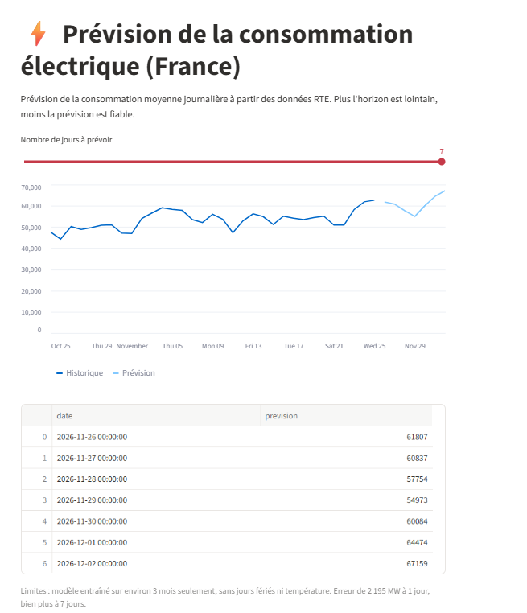

# Prévision de la consommation électrique en France

Projet de séries temporelles : prévoir la consommation d'électricité française (données RTE éCO2mix temps réel) au jour le jour, puis sur 7 jours.

## Question

Peut-on prévoir la consommation de demain, et des 7 jours suivants, à partir du passé récent ?

## Données

- Jeu **éCO2mix national temps réel** (RTE), mesures toutes les 15 minutes.
- Période : du 1er septembre au 25 novembre 2026, soit environ 86 jours.
- Regroupement en **moyenne journalière** (MW). Après création des variables : 79 jours exploitables.

## Démarche

1. Regroupement des 96 mesures quotidiennes en une valeur par jour.
2. Variables : jour de la semaine, consommation d'hier, consommation d'il y a 7 jours.
3. Séparation **dans l'ordre du temps** : 62 jours d'entraînement, 17 jours de test (jamais de mélange aléatoire, pour ne pas utiliser le futur).
4. Comparaison à des **baselines** simples.
5. Analyse des erreurs jour par jour.
6. Prévision récursive sur 7 jours.
7. Dashboard Streamlit.

## Résultats (erreur moyenne absolue, 17 jours de test)

| Méthode | Erreur (MW) |
|---|---|
| Règle « comme il y a 7 jours » | 3 554 |
| LightGBM | 3 563 |
| Règle « comme hier » | 2 912 |
| **Régression linéaire** | **2 195** |
| Régression linéaire, hors 11 novembre | 1 652 |

- La régression linéaire gagne : environ 4 % d'erreur sur 50 000 MW.
- LightGBM ne fait pas mieux : peu de données, et les arbres extrapolent mal une hausse (hypothèse plausible, non démontrée).
- Ajouter la variable week-end n'a rien apporté de mesurable (2 277 MW).

### Le jour férié du 11 novembre

Ce seul jour pèse environ 25 % de l'erreur : le modèle ne connaît pas les jours fériés. Il ne manquait pas de puissance, il manquait une information.

### Prévision sur 7 jours

Sur une fenêtre de test (9 au 15 novembre), l'erreur moyenne monte à **7 121 MW**. Chaque prédiction sert de point de départ à la suivante, donc l'erreur se transmet et grossit. Le premier jour est précis (écart de 367 MW).

## Application



Curseur de 1 à 7 jours, courbe historique et prévision.

## Limites

- Seulement 3 mois de données : pas de cycle été/hiver.
- 17 jours de test : les résultats sont des indices, pas des certitudes.
- Le test à 7 jours repose sur une seule fenêtre, qui contient un jour férié.
- Pas de température ni de jours fériés dans le modèle.

## Pistes d'amélioration

- Utiliser le jeu « consolidé et définitif » (plusieurs années).
- Ajouter la température et un calendrier des jours fériés.
- Évaluer sur plusieurs fenêtres de 7 jours.

## Lancer le projet

```bash
git clone https://github.com/fat825/conso-electricite-prevision.git
cd conso-electricite-prevision
python -m venv venv
venv\Scripts\activate        # Mac/Linux : source venv/bin/activate
pip install pandas numpy matplotlib scikit-learn lightgbm streamlit joblib
```

Les données brutes ne sont pas incluses : télécharger **éCO2mix national temps réel** sur data.gouv.fr et placer le CSV dans